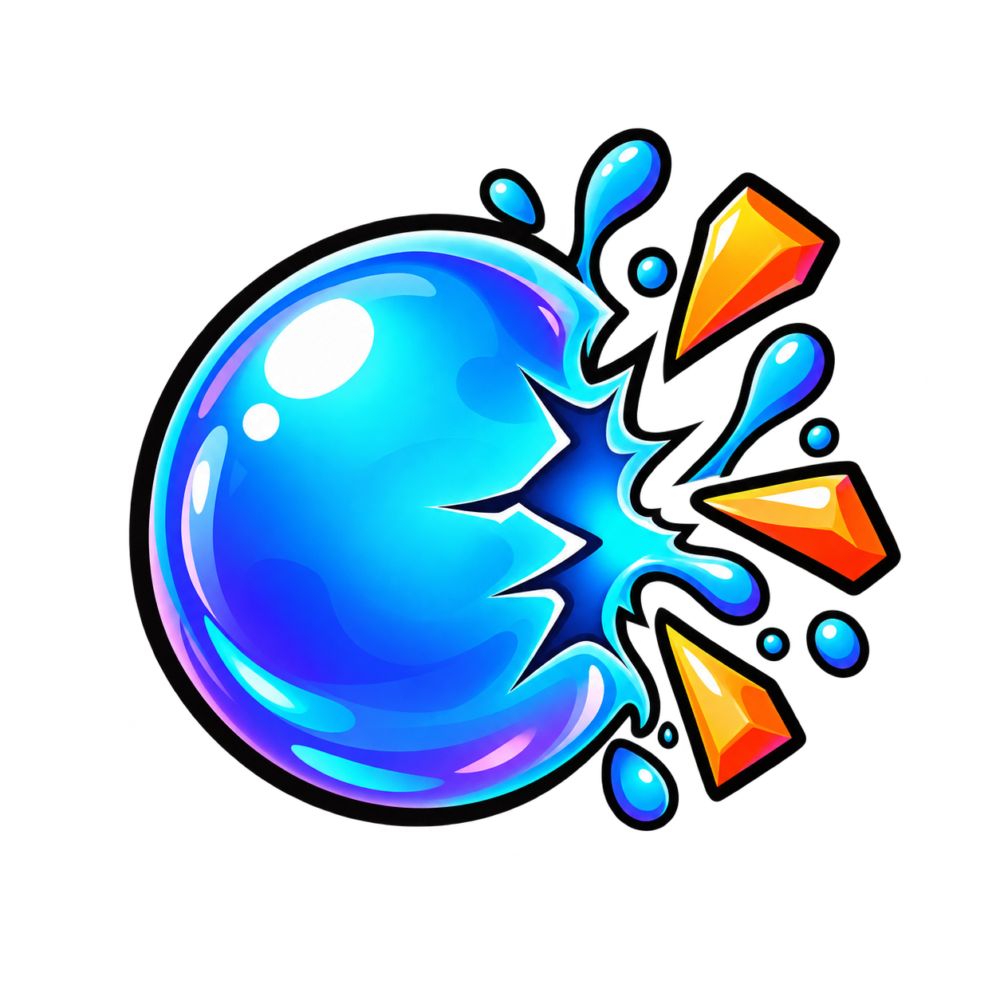

# Bubble Blast Pro

A precision bubble-popping time trial. Pop the bubble that matches the **target**
number before the clock runs out — chase a perfect streak, then watch it break.

<p align="center">
  
</p>

<!-- Replace the URL below if the deployment ever moves. -->
### 🔗 **Live Demo:** [bubble-blast-pro.vercel.app](https://bubble-blast-pro.vercel.app)

---

## How to play

1. A **target** number is shown at the top of the board.
2. Pop the bubble carrying that number — click or tap it (bubbles are
   pointer-only, there are no number-key shortcuts).
3. Every round is a race against the clock.

### Scoring

| Event | Points |
| --- | --- |
| Correct pop | **+10** |
| Wrong pop | **−5** (score never drops below 0) |
| Every 5-streak | **+25** bonus |

Accuracy and best streak are tracked and shown on the round-over screen. Your
best score is saved locally in the browser.

## Difficulty modes

| Mode | Drift | Bubble overlap | Number behaviour |
| --- | --- | --- | --- |
| **Easy** | — | — | popped bubble re-rolls, positions fixed |
| **Medium** | — | — | all numbers re-roll after each hit |
| **Hard** | ✅ bounce | — | all numbers re-roll + speed burst |
| **Extreme** | ✅ bounce | ✅ free piling | all numbers re-roll + speed burst |
| **Custom** | your choice | your choice | popped / all / frozen |

Round length is chosen on the setup screen: **30s** sprint, **60s** classic,
**90s** marathon, or **∞ unlimited** — no clock at all. In an unlimited round the
HUD stops counting down and counts *up* instead, and the round runs until you
pause and choose **End round**.

## Features

- **Pure vanilla** — no frameworks, no build step, no dependencies.
- **Canvas ambient background** with a theme-aware drifting glow.
- **Two themes** — Midnight (dark) and Daylight (bright), remembered between visits.
- **Liquid board animation** — FLIP-style reordering that glides instead of snapping.
- **Blast FX** — crack flash, shockwave ring and shard burst on every correct pop.
- **Sound effects** for hits, misses and round-over, with a mute toggle.
- **Haptic feedback** on supported devices (Vibration API) — distinct pulses for
  hits, misses and streak bonuses, with its own on/off toggle.
- **Pointer-only popping** — click or tap the bubble; `Space`/`Esc` pause and
  `Enter` starts a round from the setup screen.
- **Responsive** and touch-friendly, with `prefers-reduced-motion` support.

## Controls

| Input | Action |
| --- | --- |
| Click / tap a bubble | Pop it |
| `Space` / `Esc` | Pause / resume |
| `Enter` | Start a round from the setup screen |
| `☾` / `☀` | Toggle theme |
| `♪` | Toggle sound |
| `≈` | Toggle vibration |

## Run locally

It's a static site — any file server works.

```bash
# Python 3 (no install needed)
python -m http.server 8000
# then open http://localhost:8000
```

```bash
# or Node
npx serve .
```

Opening `index.html` directly in a browser also works, though a local server is
recommended so the audio and favicon assets resolve consistently.

## Project structure

```
Bubble-Blast-Pro/
├── index.html              # markup: top bar, HUD, board, overlays
├── style.css               # themes, layout, animations
├── script.js               # game loop, scoring, FX, drift engine, haptics
├── logo.png                # source logo artwork
├── favicon.ico             # multi-size tab icon (16/32/48/64)
├── favicon-32.png
├── favicon-64.png
├── apple-touch-icon.png
├── timer_end_sound.mp3
├── score_increase_sound.mp3
└── score_decrease_sound.mp3
```

## Tech

Plain HTML, CSS and JavaScript. The background is drawn on a 2D canvas; all
motion is transform/opacity based. No bundler, no package manager, no
dependencies.

## Deploying

Because there is no build step, you can publish the repository as-is:

- **GitHub Pages** — Settings → Pages → deploy from the `main` branch, root folder.
- **Netlify / Vercel / Cloudflare Pages** — point them at the repo, no build command,
  publish directory `.` (the project root).

This project is currently deployed on **Vercel**:
<https://bubble-blast-pro.vercel.app>

## License

Released for personal and educational use.
